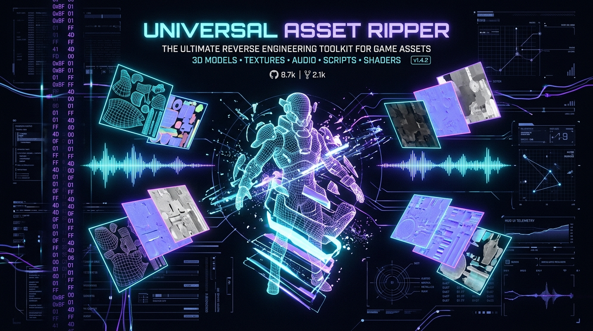

# Universal Asset Ripper

<p align="center">
  
</p>

<p align="center">
  <strong>High-performance multi-engine game asset extractor, native container parser, and AI-assisted reverse engineering orchestrator.</strong>
</p>

<p align="center">
  <a href="#-features"></a>
  <a href="https://nodejs.org/"></a>
  <a href="https://www.typescriptlang.org/"></a>
  <a href="#-mcp-server"></a>
  <a href="LICENSE"></a>
</p>

---

## 📖 Overview

**Universal Asset Ripper** is an engine-agnostic extraction and binary reverse engineering platform designed for game developers, modders, and security researchers. It seamlessly bridges native binary format parsers with AI pair-programming agents via the **Model Context Protocol (MCP)** and integrates into an advanced software reverse engineering (SRE) toolchain.

Whether analyzing **Godot** archives, **Unreal Engine** IoStore/PAK containers, **Unity** IL2CPP metadata, or desktop **Windows PE** executables, Universal Asset Ripper provides lightning-fast heuristic detection, categorized asset inventories, targeted extraction, and deep binary entropy inspection for cryptographic keys.

---

## 🎯 Features

* 🔍 **Automatic Engine & Framework Detection (`ripper detect`) :**
  - Heuristics and signature analysis for **Unity**, **Unreal Engine**, **Godot** and **Electron** (engine `electron` when an `app.asar` / `resources.pak` sits next to an Electron executable).
  - Application framework detection (**Delphi**, **.NET**, **Electron**, **Qt**, **Native C/C++**); the PE framework info is kept in `details.framework`.
  - PE header architecture analysis (x86, x64, ARM64) and encryption flagging.
* 📦 **100% Native Pure TypeScript Parsers :**
  - **Godot PCK :** Zero-dependency parser for standalone `.pck` packages and embedded executables (`GDPC` magic) supporting format versions 1 through 4.
  - **Unreal `.pak` index (v1-v11) :** lists and extracts stored, Zlib and Gzip entries natively, with AES-256 (ECB) decryption of the index and of entries (`--aes-key`, hex with/without `0x` or base64). Oodle and other codecs, and anything the native reader cannot parse, fall back to the `repak` CLI.
  - **Electron :** `app.asar` (incl. `.unpacked` files) and Chromium `resources.pak` (v3/v4/v5, extracted as `res_<id>.<ext>`, extension guessed from magic numbers - heuristic).
  - **Godot encrypted PCK :** directory and per-file AES-256-CFB decryption with the script encryption key (`--aes-key`, 64 hex chars); `--convert` writes `.ctex`/`.stex` that wrap a plain PNG/WebP as images.
  - **Windows PE (.rsrc) :** Complete multi-resolution `.ico` icon reconstruction, Delphi `.dfm` form extraction, **Win32 dialog template decoding (`RT_DIALOG` → JSON with title + every control label — DLGTEMPLATE and DLGTEMPLATEEX incl. the `01 00 ff ff` compiled header order)**, XML manifests, bitmaps, and raw `RCDATA`.
* 📊 **Asset Manifest & Inspection (`ripper inspect`) :**
  - Full cataloging across unified categories: textures, 3D meshes, audio, scenes, scripts, shaders, fonts, videos, and manifests.
* ⚡ **Targeted Extraction (`ripper extract`) :**
  - Category filtering (`--categories texture,audio,mesh`) and regex/glob filename filtering (`--filter`).
  - **AES-256** keys (`--aes-key <key>`) for Unreal `.pak` and Godot PCK; `--convert` for Godot textures; Unity export through AssetRipper headless web mode (`ASSETRIPPER_PATH`).
* 🤖 **AI-Assisted Binary Analysis (`ripper rea-inspect`) :**
  - The whole file is scanned in overlapping chunks; false positives are filtered (hex runs longer than 64, counting tables, low entropy, repeated blocks) and counts are reported honestly (`N candidates, showing M`).
  - `--pak <file>` verifies every candidate against an Unreal pak (verified keys first); `--bundle <file>` saves the evidence bundle; `--json` prints scan + bundle.
  - Sliding-window Shannon entropy scanning to spot 256-bit encryption keys.
  - Proximity search around Rijndael S-Box lookup tables (`0x63, 0x7c, 0x77, 0x7b...`).
  - Header sniffing and version validation for Unity IL2CPP `global-metadata.dat`.
  - Automated generation of structured **Evidence Bundles** formatted for AI agents.
* 🔌 **Integrated Model Context Protocol (MCP) Server (`ripper mcp`) :**
  - Exposes extraction, inspection, and scanning tools over standard I/O for Claude Code, Gemini CLI, Cursor, and Antigravity.
* 🎨 **Downstream Modding Pipeline Ready :**
  - Feeds extracted assets and decrypted structures directly into generative game modding frameworks such as [rehan-remade/universal-modder](https://github.com/rehan-remade/universal-modder) (fal.ai / ComfyUI asset replacement and in-game testing).

---

## 🧬 Clean-Room Reimplementation Workflow

The PE recon capabilities power a proven **inventory → port** pipeline for
installed Windows software (observation only — resources, built-in usage,
embedded help; never decompilation):

1. `ripper detect` / `ripper extract` over the installation → dialog,
   string and help inventories (the feature map)
2. capture the CLI tools' built-in usage text (authoritative)
3. write a precise inventory document (executables, DLL→OSS mapping,
   windows, options, coverage statuses)
4. clean-room port (e.g. Rust) verified against an in-process mock server

Packaged as the **`clean-room-port` skill** (`.zcode/skills/` in this
repository), documented in
[docs/workflow-clean-room-reimplementation.md](docs/workflow-clean-room-reimplementation.md).
Worked example: the **Bitvise SSH Client** port — CLI + egui GUI + Bitvise
option compatibility — in [`bitvise-rs/`](bitvise-rs/README.md), with its
[precise inventory](bitvise-rs/docs/inventory.md) (16 executables, 57
decoded dialogs).

## 🏗️ Architecture

```
                                ┌────────────────────────────────┐
                                │   Universal Asset Ripper       │
                                │   (CLI & MCP stdio Server)     │
                                └──────────────┬─────────────────┘
                                               │
                    ┌──────────────────────────┴──────────────────────────┐
                    ▼                                                     ▼
      [ EngineDetector Engine ]                                 [ ReaBridge & AI Hub ]
  (Unity, Unreal, Godot, Electron, PE)                        (BinaryScanner, Shannon Entropy,
                    │                                         AES-256 discovery, Evidence)
       ┌────────────┼────────────┬────────────┐                           │
       ▼            ▼            ▼            ▼              ┌────────────┼────────────┐
  [ Godot ]    [ Unreal ]    [ Unity ]   [ PE Soft. ]        ▼            ▼            ▼
  Adapter       Adapter       Adapter     Adapter       [ Ghidra ]   [ Cpp2IL ]    [ Frida ]
  (Native       (repak /    (AssetRipper (Resource      (Native SRE   (IL2CPP ->   (Runtime
  PCK reader)  CUE4Parse)    CLI bridge)  Extractor)    Decompiler)    C# .NET)     Hooking)
```

---

## 🚀 Installation & Quick Start

### Prerequisites
* **Node.js** >= 22.0.0
* **npm** >= 10.0.0

### Global CLI Installation
Clone and build the repository locally:

```bash
git clone https://github.com/laurentvv/universal-asset-ripper.git
cd universal-asset-ripper
npm install
npm run build
npm link
```

Verify your installation:
```bash
ripper --help
```

---

## 💻 CLI Usage

### 1. Detect Game Engine & Framework
Inspect any folder, game directory, or executable:
```bash
ripper detect "C:/Games/MyGame"
# Or point directly to an executable:
ripper detect "C:/Games/MyGame/MyGame.exe"
```

### 2. Inspect Package Manifest
Display categorized file counts and size breakdowns without writing to disk:
```bash
ripper inspect "C:/Games/MyGame/game.pck"
# Encrypted Unreal pak index / Godot directory: pass the key
ripper inspect "PakChunk0.pak" --aes-key 0x4A6B... --json
```

### 3. Extract Assets
Extract all assets or filter by specific categories:
```bash
# Full extraction
ripper extract "C:/Games/MyGame" -o "./extracted"

# Extract only textures and audio files
ripper extract "C:/Games/MyGame" -o "./extracted" --categories texture,audio

# Extract Unreal PAK with AES key
ripper extract "C:/Games/MyGame/Content/Paks/PakChunk0.pak" -o "./extracted" --aes-key 0x4A6B...

# Godot: convert PNG/WebP-backed .ctex/.stex textures to images
ripper extract game.pck -o ./extracted --convert

# Electron app (app.asar and resources.pak)
ripper extract "C:/Apps/MyElectronApp" -o ./extracted

# Unity: needs AssetRipper.GUI.Free; set ASSETRIPPER_PATH (file or folder) or add it to PATH
ripper extract "C:/Games/UnityGame" -o ./extracted
```

### 4. Deep Binary Inspection (AI Evidence Bundle)
Scan an executable for cryptographic keys, S-Box constants, and IL2CPP metadata:
```bash
ripper rea-inspect "C:/Games/MyGame/Game-Win64-Shipping.exe"
# Verify candidates against a pak, save the evidence bundle, machine-readable output
ripper rea-inspect Game-Win64-Shipping.exe --pak Content/Paks/PakChunk0.pak --bundle ./evidence.json
ripper rea-inspect Game-Win64-Shipping.exe --json   # { scan, bundle }
```

All commands accept `--json` (pure JSON on stdout).

### Honest limitations
* The native pak reader was written from the UE / repak format and tested against synthetic paks built by a test writer, not against commercial game archives. Pak v12+, IoStore (`.utoc/.ucas`), Oodle and Zstd are not handled natively (IoStore is unsupported; Oodle goes through `repak`, which unpacks whole containers, so it cannot honour `--categories/--filter`).
* Godot encryption (AES-256-CFB, md5|size|iv|data) follows the engine source but is validated only against our own encryptor. `.ctex` conversion lifts plain PNG/WebP payloads only (no WebP-to-PNG re-encoding, no VRAM-compressed textures).
* AssetRipper is driven through its headless web API (form field `Path`); the endpoints are tested with a fake server only, and `--categories/--filter` are not supported for Unity.
* Electron: unpacked `resources/app` folders are not listed; Chromium `.pak` extension guessing is heuristic.
* Key verification with a plain (unencrypted) pak index can only probe an encrypted entry; otherwise candidates stay `unverifiable`.

---

## 🤖 MCP Server Setup (AI Agents)

Universal Asset Ripper runs as a standard **Model Context Protocol (MCP)** server over `stdio`. It connects natively with **Claude Code**, **Gemini CLI**, **Cursor**, and **Antigravity**.

Add the server to your `mcpServers` configuration file:

```json
{
  "mcpServers": {
    "universal-asset-ripper": {
      "command": "node",
      "args": ["C:/git/universal-asset-ripper/dist/cli/index.js", "mcp"]
    }
  }
}
```

### Restricting file access

By default the MCP tools accept any path. To confine an agent to specific folders, pass `--root` (repeatable) or set `UAR_ALLOWED_ROOTS` (path-delimited: `;` on Windows, `:` elsewhere). Every `targetPath`, `binaryPath`, `pakPath` and `outputDir` must then resolve (symlinks followed) inside one of the roots, otherwise the call returns an error.

```json
"args": ["C:/git/universal-asset-ripper/dist/cli/index.js", "mcp", "--root", "D:/Games", "--root", "D:/Extracted"]
```

### Tools Exposed to Agents
| Tool Name | Description |
| :--- | :--- |
| `ripper_detect` | Run heuristic analysis to detect the game engine, architecture, and container type. |
| `ripper_inspect` | Return a complete manifest of files with counts and sizes grouped by category. |
| `ripper_extract` | Extract assets to disk with category filters and optional AES-256 decryption keys. |
| `ripper_scan_binary` | Run Shannon entropy scans, find AES keys (optional `pakPath` verification), and extract IL2CPP metadata headers. |

---

## 🔬 Reverse Engineering Ecosystem

Universal Asset Ripper forms the upstream reconnaissance and extraction hub within a comprehensive SRE toolchain:

| Tool | Category | Specialty & Role in Pipeline |
| :--- | :--- | :--- |
| **[morluto/rea](https://github.com/morluto/rea)** | Agentic SRE | Autonomous LLM agents consuming Evidence Bundles to plan reverse engineering steps. |
| **[Ghidra](https://github.com/NationalSecurityAgency/ghidra)** | Static SRE | Deep native disassembly and C pseudocode decompilation (x86/x64/ARM). |
| **[Cpp2IL](https://github.com/SamboyCoding/Cpp2IL)** | Unity IL2CPP | Reconstructs executable CIL (.NET) bytecode from `GameAssembly.dll` for decompilation in dnSpy/ILSpy. |
| **[JADX](https://github.com/skylot/jadx)** | Android SRE | Dex-to-Java decompiler for unpacking APK/AAB packages, manifests, and JNI bridges. |
| **[Frida](https://github.com/frida/frida)** | Dynamic SRE | Runtime memory hooking to capture live AES keys and dump uncompressed asset buffers. |
| **[universal-modder](https://github.com/rehan-remade/universal-modder)** | Modding Studio | Downstream mod injection, generative AI assets (fal.ai/ComfyUI), and in-game automated testing. |

---

## 📚 Technical Documentation

* 📘 [Detailed Architecture](docs/architecture.md)
* 📗 [Engine Deep Dive & Tooling Guide](docs/engines.md)
* 📙 [REA & AI Agent Integration Guide](docs/rea-guide.md)

---

## 🧪 Testing

The test suite validates parser accuracy against synthetically generated binary containers (PE headers, Godot PCK archives, and AES memory blocks):

```bash
npm test
```

Check your environment (Node.js, repak, AssetRipper, rea) with `ripper doctor` (`--json` for machine-readable output).

---

## 🛠️ Development

```bash
npm ci                  # install
npm run lint            # ESLint (flat config, typescript-eslint)
npx tsc --noEmit        # type check
npm run build           # compile to dist/
npm test                # build + vitest
npm run test:coverage   # vitest with v8 coverage
npm run clean           # remove dist/ and coverage/
```

CI (`.github/workflows/ci.yml`) runs lint, build and tests on Ubuntu and Windows with Node 22 and 24.

---

## 📄 License

MIT © [Laurent VOLFF](https://github.com/laurentvv)
